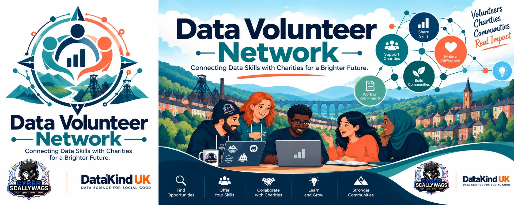

<!-- Badges are generated from project.toml by `uv run task sync`. -->
<p align="center">
  
</p>
<p align="center">
  <a href="https://cyberscallywags.com"></a>
  In partnership with <a href="https://cyberscallywags.com">Cyber Scallywags</a>
</p>

<!-- sync:header -->
---

[](https://github.com/cyberscallywags/data-volunteer-network/actions/workflows/ci.yml)
[](https://github.com/cyberscallywags/data-volunteer-network/actions/workflows/release.yml)
[](https://codecov.io/gh/cyberscallywags/data-volunteer-network)
[](.python-version)
[](https://github.com/cyberscallywags/data-volunteer-network)
[](https://github.com/cyberscallywags/data-volunteer-network)
[](https://github.com/cyberscallywags/data-volunteer-network/issues)
[](https://github.com/cyberscallywags/data-volunteer-network/pulls)
[](https://github.com/cyberscallywags/data-volunteer-network/stargazers)
[](https://github.com/cyberscallywags/data-volunteer-network/network/members)
[](https://github.com/cyberscallywags/data-volunteer-network/commits)
[](https://github.com/astral-sh/uv)
[](https://github.com/astral-sh/ruff)
[](.pre-commit-config.yaml)
<!-- /sync:header -->

<b>This Cyber Scallywags base template.</b> </br>
The smallest stack that connects every part and is ready to
be renamed and grown into a real project.

| Service | Tech | Local URL |
|---|---|---|
| `api` | FastAPI + Pydantic AI | http://localhost:8000/docs |
| `ui` | FastUI (Pydantic-declared React UI) | http://localhost:8080 |
| `admin` | Streamlit | http://localhost:8501 |
| `mobile` | Ionic + Angular (served by nginx, proxies `/api`) | http://localhost:8100 |
| `docs` | Zensical portal + Sphinx/Furo manual | http://localhost:8200 |
| `neo4j` | Neo4j Enterprise, evaluation licence | http://localhost:7474 |

## Quick start

```bash
uv sync                    # Python 3.14 + the dev and docs tools
uv run pre-commit install
uv run task --list         # every task
uv sync --all-groups       # + Playwright, Locust and Streamlit, for the full gate
uv run playwright install chromium   # the only browser the e2e tests use
uv run task verify         # lint → unit → build+start stack → integration → browser → Locust → teardown
```

## Start a new project from this template

The worked example below turns Sgaffald into **Data Volunteer Network**.

### 1. Create the repository (don't copy and paste the folders)

Copying folders by hand drops dotfiles (`.github/`, `.env.*`, `.pre-commit-config.yaml`,
`.python-version`) and loses the link back to the template. Pick one of these instead:

- **From a GitHub template (recommended, clean history).** Tick *Settings → General →
  Template repository* on `sgaffald` once, then either press **Use this template** or run:

  ```bash
  gh repo create cyberscallywags/data-volunteer-network \
    --template cyberscallywags/sgaffald --public --clone
  ```

- **Clone and re-point (keeps the template's history, so later template fixes can be merged in).**

  ```bash
  git clone https://github.com/cyberscallywags/sgaffald.git data-volunteer-network
  cd data-volunteer-network
  git remote rename origin template
  gh repo create cyberscallywags/data-volunteer-network --public --source . --push
  # later, to pick up template improvements:
  git fetch template && git merge template/main
  ```

Make the renaming changes below on a branch (for example `task/rename-from-template`) and open a
PR. After `uv run pre-commit install`, the pre-push hook blocks pushes to `main`.

### 2. Set the identity: `project.toml`, then `uv run task sync`

| Field | Sgaffald | Data Volunteer Network |
|---|---|---|
| `project.name` | `Sgaffald` | `Data Volunteer Network` |
| `project.slug` (lower-case; images, compose project) | `sgaffald` | `data-volunteer-network` |
| `project.description` | `Cyber Scallywags base template: …` | `Connects volunteers with organisations that need their data skills` |
| `project.year` | `2026` | the copyright year |
| `organisation.name` / `url` / `motto` | Cyber Scallywags | keep, or the owning organisation |
| `repository.owner` | `cyberscallywags` | `cyberscallywags` |
| `repository.name` | `sgaffald` | `data-volunteer-network` |
| `mobile.app_id` (reverse-DNS, no hyphens) | `com.cyberscallywags.sgaffald` | `com.cyberscallywags.datavolunteernetwork` |

`uv run task sync` then rewrites every copy that the code cannot read directly. Don't edit these
by hand:

- `README.md` badges
- `docs/zensical.toml` site name and footer
- `.env.project` compose project and image prefixes
- `pyproject.toml` description
- `mobile/package.json`, `package-lock.json`, `ionic.config.json`, `src/index.html` title,
  `src/app/core/meta.json` and `src/theme/_brand.scss`

`uv run task test` fails if any of them are stale.

### 3. Set the version: `pyproject.toml`

- `version`: reset to `0.1.0` for the new project.

### 4. Set the brand and content: `src/data_volunteer_network/content/site.json`

| Field | Change to |
|---|---|
| `brand.tagline` | e.g. `Data skills, where they're needed.` |
| `brand.name`, `brand.collective`, `brand.collective_url` | optional; default to `project.name` and `organisation.name` |
| `theme.primary` / `secondary` / `tertiary` | the new brand colours |
| `welcome` and the pages | the project's own welcome page and sidebar pages |

Run `uv run task sync` again afterwards so the mobile app's first paint uses the new colours. See
[Site manifest](docs/content/site-manifest.md).

### 5. Rename the Python package (optional)

Identity no longer depends on the package name, so you can keep `sgaffald`. To rename it:

```bash
git mv src/sgaffald src/data_volunteer_network
git grep -l sgaffald -- '*.py' '*.sh' '*.ts' pyproject.toml .env.test \
  | xargs perl -pi -e 's/\bsgaffald\b/data_volunteer_network/g'
uv lock
```

That covers `[project] name`, the `sgaffald[...]` extras, `force-include`, `--cov` and the
coverage `omit` in `pyproject.toml`, the imports, `serve.py` and
`docs/sphinx/conf.py`. Afterwards, fix the two tests that assert on the old slug or title by
hand: `tests/unit/test_docs.py` (`PROJECT_SLUG`) and `tests/e2e/test_docs_site.py` (the portal
`h1` anchor).
The replacement also turns the Neo4j test password `sgaffald-test-only` into
`<package>-test-only`; that still works, but the slug form (`data-volunteer-network-test-only`)
reads better.

### 6. Model the domain

Replace the sample `Item` with your own models, for example `Volunteer` and `Opportunity`:

- `models.py`: `Item` / `ItemIn`
- `db.py`: `ItemRepo`
- `api/main.py`: the `/items` routes
- `admin/app.py`
- `ui/main.py`
- `mobile/src/app/core/api.service.ts`, `mobile/src/app/pages/items/` and
  `mobile/src/app/features.ts`

The tests show the pattern for each layer.

### 7. Replace images and styling

- `brand/`: the emblem, banner and mark masters. Replace them, then run `uv run task images` to
  regenerate every size in `docs/content/assets/images/` and `mobile/src/assets/icon/`. The
  generated files have role names (`brand-emblem-512.webp`), so no reference needs editing.
- Partner credits (`csw-crest-*`, `csw-mark-*`) are kept as they are.
- `docs/content/assets/stylesheets/brand.css`

### 8. Environments

- `.env.test`: `NEO4J_PASSWORD` (a throwaway value; the tests read the same one).
- `.env.production`: copy it from `.env.production.example` and fill it in. It is never
  committed. Set a real `LLM_MODEL` and add its provider extra, e.g. `pydantic-ai-slim[anthropic]`.

### 9. GitHub repository settings (not copied by a template)

- Secrets and variables:
  - `CODECOV_TOKEN` secret
  - `PROJECT_URL` variable and `PROJECT_TOKEN` secret, for the issue → project workflows
- Branch rules on `main` and the GHCR package visibility. See
  [One-off repository setup](docs/content/development/ci-cd.md#one-off-repository-setup).

### 10. Clean up and check

- Delete `reports/`.
- Rewrite the intro above and the pages in `docs/content`: `index.md`, `about.md` and
  `getting-started.md`.
- `git grep -i sgaffald` lists anything left over.
- `uv run task verify` runs the full gate.

The fuller guide is [Make it yours](docs/content/guides/make-it-yours.md).

## Documentation

Everything else (architecture, the site manifest, each service, testing, environments, CI/CD,
repository setup, and the generated HTTP API, data model, configuration and task references)
lives in the docs, built from [`docs/content`](docs/content):

```bash
uv run task docs_serve     # build both sites, serve on http://localhost:8200
```

- **Portal** (Zensical) at `/`: start here.
- **Reference manual** (Sphinx + Furo) at `/manual/`: the same pages plus the Python API from docstrings.

With the stack running (`uv run task up`) the `docs` container serves both on
http://localhost:8200, and the web UI and mobile app link to it. Reference pages are generated
from the code by `python -m data_volunteer_network.docgen`, so they cannot drift; see
[The docs site](docs/content/services/docs.md).
