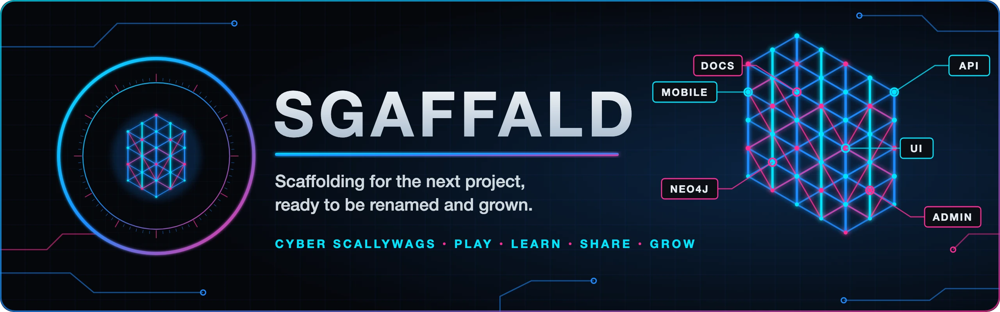

<!-- Title and badges are generated from project.toml by `uv run task sync`. -->
<p align="center">
  
</p>

<!-- sync:header -->
# Sgaffald

[](https://github.com/cyberscallywags/sgaffald/actions/workflows/ci.yml)
[](https://github.com/cyberscallywags/sgaffald/actions/workflows/release.yml)
[](https://codecov.io/gh/cyberscallywags/sgaffald)
[](.python-version)
[](https://github.com/cyberscallywags/sgaffald)
[](https://github.com/cyberscallywags/sgaffald)
[](https://github.com/cyberscallywags/sgaffald/issues)
[](https://github.com/cyberscallywags/sgaffald/pulls)
[](https://github.com/cyberscallywags/sgaffald/stargazers)
[](https://github.com/cyberscallywags/sgaffald/network/members)
[](https://github.com/cyberscallywags/sgaffald/commits)
[](https://github.com/astral-sh/uv)
[](https://github.com/astral-sh/ruff)
[](.pre-commit-config.yaml)
<!-- /sync:header -->

CyberScallywags base template. The smallest stack that connects every part and is ready to
be renamed and grown into a real project.

| Service | Tech | Local URL |
|---|---|---|
| `api` | FastAPI + Pydantic AI | http://localhost:8000/docs |
| `ui` | FastUI (Pydantic-declared React UI) | http://localhost:8080 |
| `admin` | Streamlit | http://localhost:8501 |
| `mobile` | Ionic + Angular (served by nginx, proxies `/api`) | http://localhost:8100 |
| `docs` | Zensical portal + Sphinx/Furo manual | http://localhost:8200 |
| `neo4j` | Neo4j Enterprise, evaluation licence | http://localhost:7474 |

## Quick start

```bash
uv sync                    # Python 3.14 + the dev and docs tools
uv run pre-commit install
uv run task --list         # every task
uv sync --all-groups       # + Playwright, Locust and Streamlit, for the full gate
uv run playwright install chromium   # the only browser the e2e tests use
uv run task verify         # lint → unit → build+start stack → integration → browser → Locust → teardown
```

## Documentation

Everything else (architecture, the site manifest, each service, testing, environments, CI/CD,
repository setup, and the generated HTTP API, data model, configuration and task references)
lives in the docs, built from [`docs/content`](docs/content):

```bash
uv run task docs_serve     # build both sites, serve on http://localhost:8200
```

- **Portal** (Zensical) at `/`: start here.
- **Reference manual** (Sphinx + Furo) at `/manual/`: the same pages plus the Python API from docstrings.

With the stack running (`uv run task up`) the `docs` container serves both on
http://localhost:8200, and the web UI and mobile app link to it. Reference pages are generated
from the code by `python -m sgaffald.docgen`, so they cannot drift; see
[The docs site](docs/content/services/docs.md).
