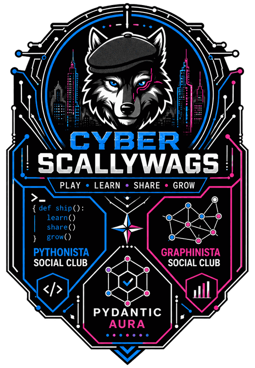

# About Cyber Scallywags

{.brand-emblem}

**PLAY • LEARN • SHARE • GROW**

We are a community-led movement helping people explore, learn, practise, and share digital
skills, data engineering, AI, graph technology, and cybersecurity. Rebellious curiosity
meets production-grade software craftsmanship.

Born in the Welsh Valleys, an open community commons, and a partner in the Data Volunteer
Network.

## How we work

| Pillar | What it means |
|---|---|
| **Play** | Social clubs and community coding nights |
| **Learn** | Free, peer-reviewed tutorials |
| **Share** | Valleys tech projects, built in the open |
| **Grow** | Mentorship and pathways |

## The clubs

| Club | Focus |
|---|---|
| **Pythonista** | Python, from first script to production service |
| **Graphinista** | Graph technology and connected data |
| **Datanista** | Data engineering |

## Built on Sgaffald

Data Volunteer Network started from *Sgaffald* (Welsh for scaffold), the template Cyber
Scallywags projects start from: tested, deployable and documented from the first commit, so
anyone can pick one up and join in.

## Find us

- Website: [cyberscallywags.com](https://cyberscallywags.com)
- Clubs: [cyberscallywags.com/clubs](https://cyberscallywags.com/clubs)
- Tutorials: [cyberscallywags.com/learn](https://cyberscallywags.com/learn)
- Events: [cyberscallywags.com/events](https://cyberscallywags.com/events)
- Manifesto: [cyberscallywags.com/about](https://cyberscallywags.com/about)
