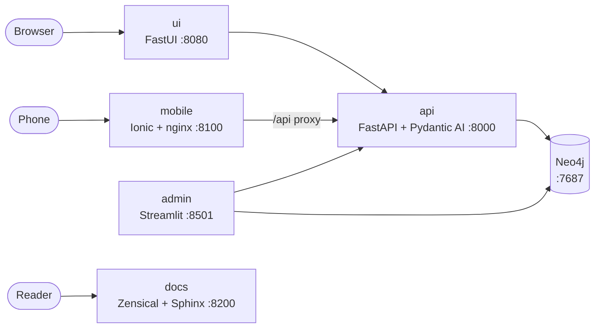

# Architecture

Every frontend talks to the API over HTTP; only the API (and the admin portal, for
administration) touches the graph. One set of Pydantic models is the contract between
all of them.



## Flows

| From | To | How |
|---|---|---|
| `ui` | `api` | Server-side `httpx`; FastUI renders the JSON components in the browser |
| `mobile` | `api` | Browser calls `/api/*` on its own origin; nginx proxies to the API, so no CORS |
| native app | `api` | Direct HTTPS; its origin must be listed in `CORS_ORIGINS` |
| `admin` | `api` and `neo4j` | Health from the API, statistics straight from the graph |
| `api` | `neo4j` | Async Neo4j driver in `sgaffald.db.ItemRepo` |
| `docs` | none | Static HTML built from `docs/content` and the code |

## One contract, every surface

| Concern | Source of truth | Used by |
|---|---|---|
| Data shapes | `src/sgaffald/models.py` | API, UI, admin, tests; mirrored in `mobile/src/app/core/api.service.ts` |
| Configuration | `src/sgaffald/config.py` (`Settings`) | Every Python service |
| Brand, theme, pages | `src/sgaffald/content/site.json`, served at `GET /site` | Web UI and mobile app |
| HTTP API | FastAPI's OpenAPI schema | Swagger UI and the generated [HTTP API](reference/http-api.md) page |
| Docs reference | `python -m sgaffald.docgen` | Both docs sites |

## Repository layout

```text
src/sgaffald/
  api/          FastAPI service (GET /health, /site, /items; POST /items, /ask)
  ui/           FastUI web frontend
  admin/        Streamlit admin portal
  mobile/       Ionic + Angular app (its own Docker image)
  content/      site.json, the site manifest, and its loader
  models.py     the shared Pydantic contract
  config.py     Settings, from environment variables
  db.py         Neo4j repository
  agent.py      Pydantic AI agent
  docgen.py     generates the docs reference pages from the code
docs/
  content/      the Markdown pages, shared by both docs sites
  sphinx/       Sphinx + Furo configuration (the manual)
  zensical.toml Zensical configuration (the portal)
docker/         Dockerfiles, nginx configs, entrypoint
tests/          unit, integration, e2e (Playwright), load (Locust)
```
